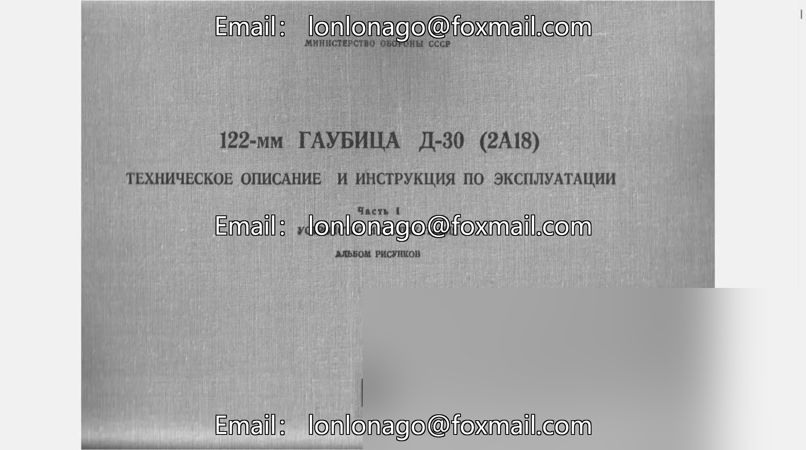
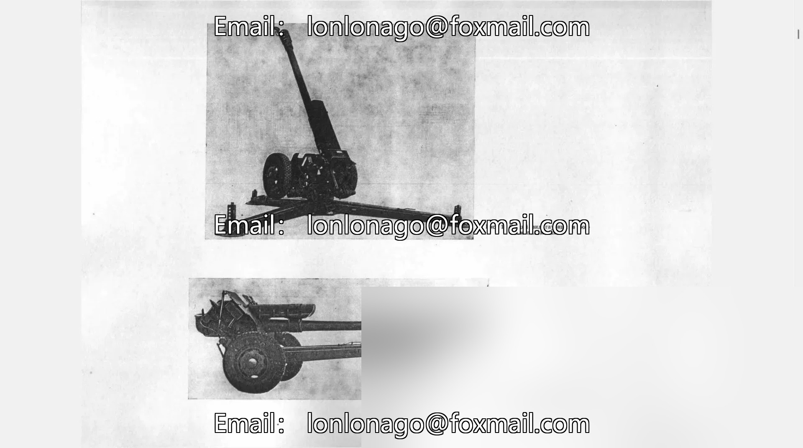
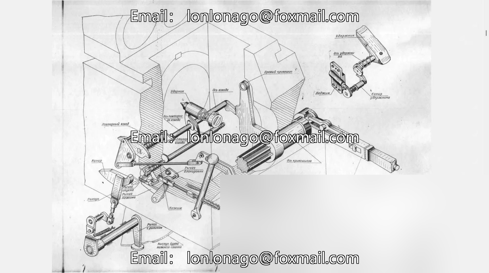
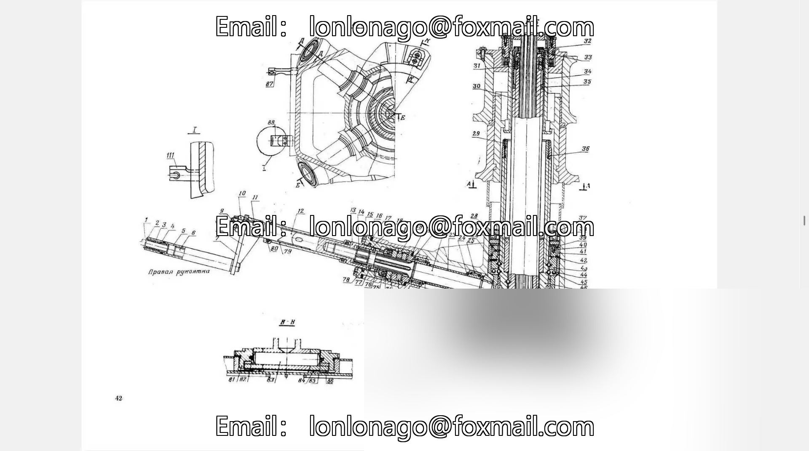
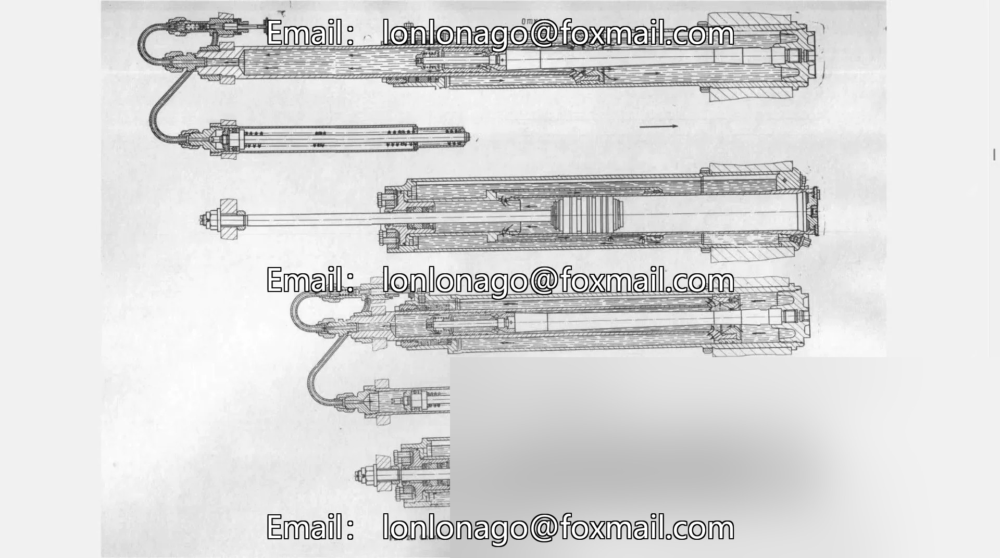

# Soviet 122-millimeter D-30 (2A18) howitzer technical manual, Russian original version.

## Body

The technical manual of the Soviet 122-mm D-30 (2A18) gun, original Russian , including detailed content such as structure, operation, maintenance, and part-wise diagrams, suitable for model verification, military enthusiasts, and collection reference.
122-mm-gaubica-d-30-albom-risunkov
copyable, not refundable upon sale.

The technical manual covers the Soviet 122mm D-30 (2A18) grenadier, including structure, operation, maintenance and part drawings, in Russian original form, with copying and no-return sale available.

<!-- AI_ENRICHED -->

## Images

## Payment

Here is a pay link on Stripe ( https://buy.stripe.com/3cs8yP7sY87d0vu9AB ). Please contact me lonlonago@foxmail.com after funding $89, and I will send you a complete data files , thank you!

